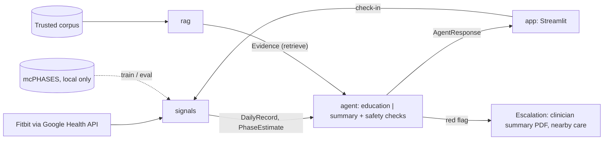

# Architecture

> **Status: draft for discussion, not final.** This is a starting proposal. Before implementing
> anything that depends on an unsettled part (open items in [decisions.md](decisions.md), or
> anything that changes this diagram or a contract), raise it with the team at standup or in an
> issue. Record the outcome in decisions.md, then update this page.

## How the layers connect

All handoffs are Pydantic models in `contracts/models.py`. Example payloads are in `contracts/fixtures/`.

| Handoff | Contract | Entry point |
|---|---|---|
| signals → agent | `DailyRecord`, `PhaseEstimate` | `get_daily_records(user_id)`, `estimate_phase(user_id)` |
| rag → agent | `Evidence` | `retrieve(query, user_context) -> list[Evidence]` |
| agent → app | `AgentResponse` | `respond(question, user_id, mode)` |

Every contract carries a `source` (`real` / `synthetic` / `mixed`) so the UI can label it.
`AgentResponse.fallback_used` marks answers served from cached or canned paths.

## Stubbed vs real

Update at each integration gate (Nov 15, Nov 19, Dec 4).

| Component | Status | Notes |
|---|---|---|
| Contracts + fixtures | real | v0.1 |
| signals: records + phase estimate | stub | fixture data, synthetic |
| signals: Google Health client | real | pulls and caches raw Fitbit data; not yet parsed into `DailyRecord` (see docs/data.md) |
| rag: retrieve | stub | placeholder evidence |
| agent: respond | stub | wires stubs; no LLM, no routing, no safety checks yet |
| app | stub | Streamlit renders `AgentResponse`; no check-in, no Cycle Clock |
| evals (all layers) | not started | planned metrics in the timeline's Sprint 2 row |
| Storage | not started | open decision |
